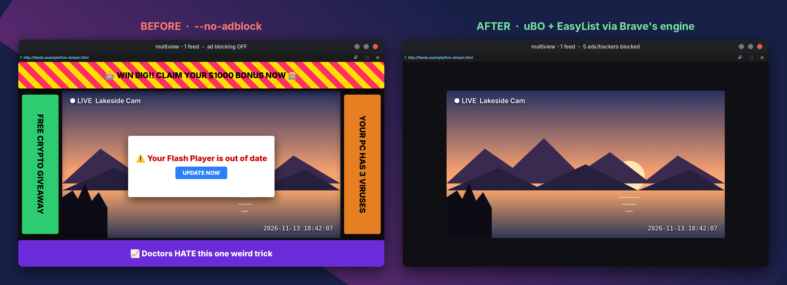

# multiview

**Watch up to four live feeds in one window, with the ads stripped out.**

Web streams, IP cameras, RTSP feeds and HLS links all play side by side in a single clean grid. One feed has the sound at a time, and a press of a key switches it. The ad blocking uses the same filter lists as uBlock Origin, run on the same engine Brave uses.

One Python file. No Electron, no Docker, nothing to configure before you press play.


---

## Why multiview?

Following several streams at once usually means four browser tabs, four sets of autoplaying ads, pop-unders opening behind your back, and hunting for whichever tab is making noise. multiview puts all of them in one window and makes it easy to manage.

- **🖥️ 2–4 feeds, one window.** Two feeds sit side by side and three or four fill a 2×2 grid. Fullscreen any single feed with one key and press it again to go back to the grid.
- **🔊 One feed has the sound.** Press `1`–`4` to choose which feed you hear; the rest stay muted. `M` mutes everything.
- **🛡️ Real ad blocking, not a hosts file.** Built on Brave's adblock-rust engine, with the uBlock Origin lists (filters, badware, privacy, quick-fixes, unbreak), EasyList, EasyPrivacy and Peter Lowe's list. It blocks ad and tracker requests in every frame and hides the empty ad boxes they leave behind.
- **🚫 No pop-ups, pop-unders or hijacked redirects.** New-window ads are dropped, `window.open()` is stubbed so ad scripts give up quietly, and an ad can't redirect a feed to some other site.
- **📼 Plays anything.** Web pages and embed players open in a built-in Chromium view. Direct streams (`rtsp://`, `.m3u8`, `.ts`, `.mp4` and more) play through VLC. You can mix both kinds in the same grid.
- **📋 Paste an `<iframe>` and go.** Hand it the embed code straight off a page and multiview pulls out the link itself.
- **🪶 Tiny and readable.** One file of plain Python and Qt that you can read in one sitting.

## Ads in, ads out

The same page, the same window. On the left multiview runs with `--no-adblock`; on the right it runs with its defaults.



The banners, sidebars and the fake "update your player" box are removed by the stock uBlock Origin and EasyList rules. The ad-network scripts behind them are blocked before they load, and the window title keeps a running count.

## Two up


> The screenshots are real captures of multiview playing sample pages made for this README. The ads are fakes, built to show what the blocker does.

---

## Install

**Ubuntu / Pop!_OS / Debian**

```bash
sudo apt install python3-pyqt6 python3-pyqt6.qtwebengine
pip install --user --break-system-packages adblock      # Brave's engine (recommended)
sudo apt install vlc python3-vlc                         # only for rtsp/m3u8/etc. feeds

git clone https://github.com/crash101g/multiview.git
cd multiview
chmod +x multiview.py
```

**macOS** (with [Homebrew](https://brew.sh))

```bash
brew install python
brew install --cask vlc                                  # only for rtsp/m3u8/etc. feeds

git clone https://github.com/crash101g/multiview.git
cd multiview
python3 -m venv .venv
source .venv/bin/activate
pip install PyQt6 PyQt6-WebEngine adblock python-vlc
chmod +x multiview.py
```

Run `source .venv/bin/activate` in each new terminal before starting multiview. python-vlc finds VLC in `/Applications/VLC.app`. Use `Ctrl`+`Cmd`+`F` for fullscreen, because macOS keeps `F11` for Show Desktop. Web feeds should work as they do on Linux. Direct streams through VLC haven't been tested on a Mac yet.

**Windows:** `pip install PyQt6 PyQt6-WebEngine adblock python-vlc` (plus VLC itself for direct streams). This should work but hasn't been tested.

Linux is the only platform multiview has been tested on so far.

## Use

```bash
# two web feeds side by side
./multiview.py https://example.com/stream-a https://example.com/stream-b

# mix a camera and a web page; an <iframe> tag works as-is
./multiview.py rtsp://192.168.1.50/live '<iframe src="https://example.com/embed/1"></iframe>'

# no arguments: uses the [feeds] list in multiview.ini
./multiview.py
```

| Key | Action |
| --- | --- |
| `1`–`4` | Give that feed the audio |
| `M` | Mute / unmute everything |
| `S` | Solo the feed with the audio full-window (press again to return) |
| `R` | Reload all feeds |
| `H` | Hide / show the title bars |
| `F11` (`Ctrl`+`Cmd`+`F` on macOS) | Fullscreen · `Esc` leaves fullscreen or solo |
| `Q` | Quit |

Each tile also has 🔊 / ⛶ / ⟳ buttons in its title bar.

## Settings

The first run creates `multiview.ini` next to the script:

```ini
[feeds]
1 = https://example.com/stream-a
2 = rtsp://192.168.1.50/live

[options]
audio = 1              ; which feed starts with the sound (0 = all muted)
block_popups = yes     ; drop pop-up / new-window ads
adblock = yes          ; uBlock Origin / EasyList filtering
lock_navigation = yes  ; stop ads redirecting a feed to another site
extra_lists =          ; more filter-list URLs, comma separated
```

### Ad blocking details

| | With `adblock` installed | Without it |
| --- | --- | --- |
| Engine | Brave adblock-rust | built-in domain matcher |
| Network filtering | full uBO / ABP syntax: paths, `$script`, `$third-party`, `$domain=` and the rest | `\|\|domain^` rules (~94k domains) |
| Hiding ad elements | site-specific and generic `##` rules | – |
| Pop-up and redirect guard | ✅ | ✅ |

- Filter lists are cached in `~/.cache/multiview/` and refreshed every 4 days, or right away with `--update-filters`. The compiled engine is cached too, so after the first run it loads in a fraction of a second.
- **Your own rules** go in `my-filters.txt` next to the script, in standard uBO syntax:
  ```
  ||annoying-ad-host.com^
  example.com##.overlay-ad
  @@||cdn-i-actually-need.com^
  ```
- Run with `-v` to print every blocked request, which helps when writing rules.
- `--no-adblock` turns blocking off for one run.

**Known limit:** uBO's `##+js(...)` scriptlet rules (mostly used against anti-adblock walls) aren't run, because their code isn't part of Brave's engine. Network and element-hiding rules all work.

## Notes

- **Wayland (GNOME, KDE, COSMIC):** VLC can only draw into an X11 window, so when any feed uses VLC, multiview runs through XWayland automatically. With only web feeds it runs natively.
- Web views share one private, in-memory profile. Nothing is saved to disk between runs.
- multiview is a viewer. It doesn't download, record or re-share anything. Only watch streams you have the right to watch.

## License

[GPL-3.0](LICENSE) © crash101g

This is a personal project, shared as-is.
